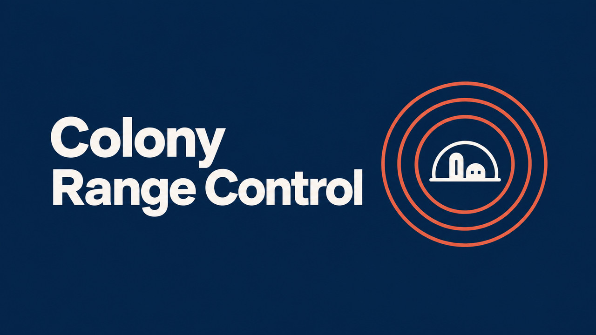

# Colony Range Control

Adjust 17 colony ranges from 1x to 10x in Surviving Mars: Relaunched. By hawshemi.

Version 1.00-001. [Paradox Mods](https://mods.paradoxplaza.com/mods/160315/Any) [All three mods](../../README.md).

## Install

Copy the contents of `mod` into `%APPDATA%\Surviving Mars Relaunched\Mods\LocalRangeExtender`. Enable the mod in Mod Manager and restart the game. Use a separate test save for the latest changes.

## Use

Choose Normal, 2x, 5x, 10x, or Custom in Mod Options. The default is 2x. Presets set all 17 sliders. Changing a slider selects Custom and keeps the other values. Apply to update colony ranges and view the range report. Larger heater and scrubber ranges still use more power.

## Included controls

- Changes how far colonists can reach outside workplaces and stations from domes.
- Changes the area drones can serve around each Drone Hub.
- Changes the area drones can serve around RC Commanders and compatible rovers.
- Changes the area drones can serve around each rocket.
- Changes the area drones can serve around each linked Drone Hub Extender.
- Changes how far Triboelectric Scrubbers can clean dust from nearby buildings.
- Changes the area warmed by each Subsurface Heater.
- Changes the protection and meteor interception distances of MDS Lasers.
- Changes how far extractors can reach compatible deposits, including compatible modded extractors.
- Changes how far Sensor Towers can boost nearby sector scanning.
- Changes the solar panel illumination and heating area around Artificial Suns.
- Changes the underground area protected from cave-ins by Support Struts.
- Changes how far tourists in an RC Safari can see attractions along its route.
- Changes the maximum route length you can set for an RC Safari.
- Changes the area where each Forestation Plant can plant vegetation.
- Changes the area warmed by each working Mohole Mine.
- Changes the area warmed by Advanced Stirling Generators while open and working.

## Remove

In a loaded colony, select Normal and apply. Save, disable the mod in Mod Manager, and restart. Existing safari routes remain unchanged.

## Validation

Automated checks use the Relaunched ModTools source at Lua revision 403908. They simulate engine services. Gameplay verification of the latest changes remains pending. See [development and packaging](../../DEVELOPMENT.md) for the shared check command.

[MIT license](LICENSE).
